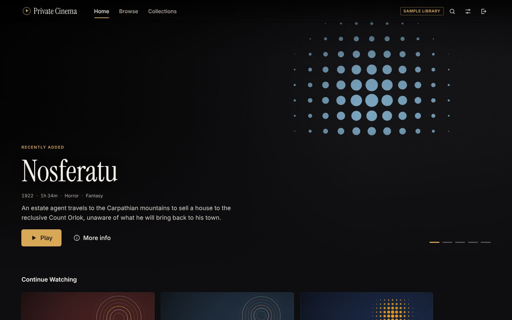
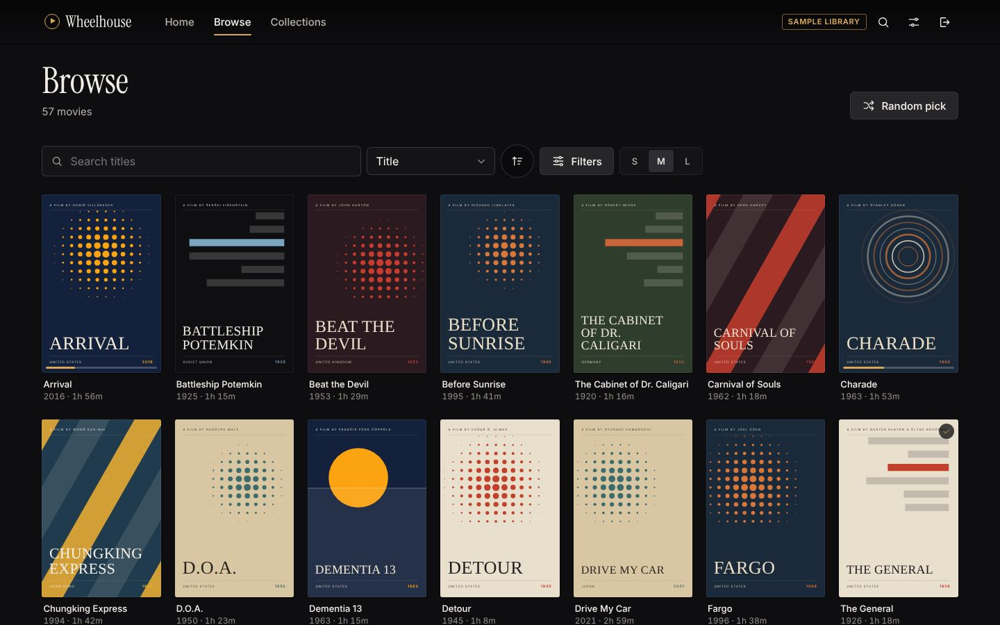
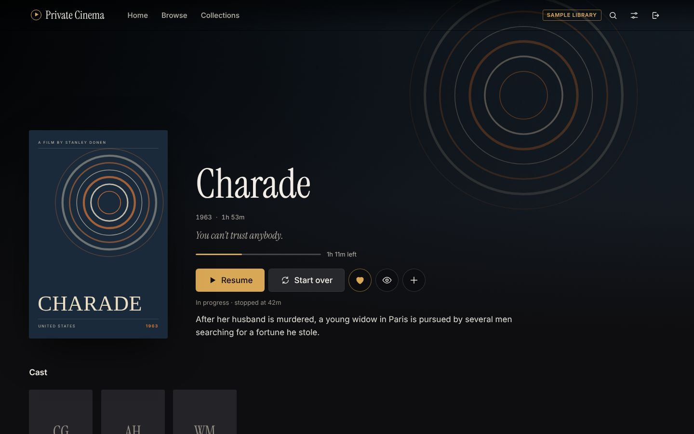
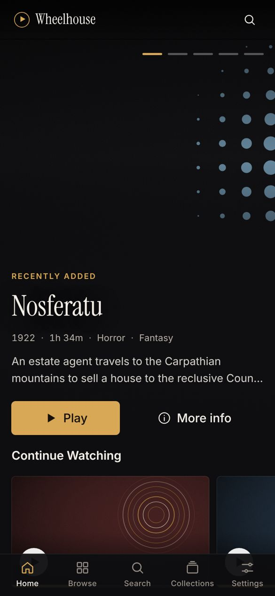
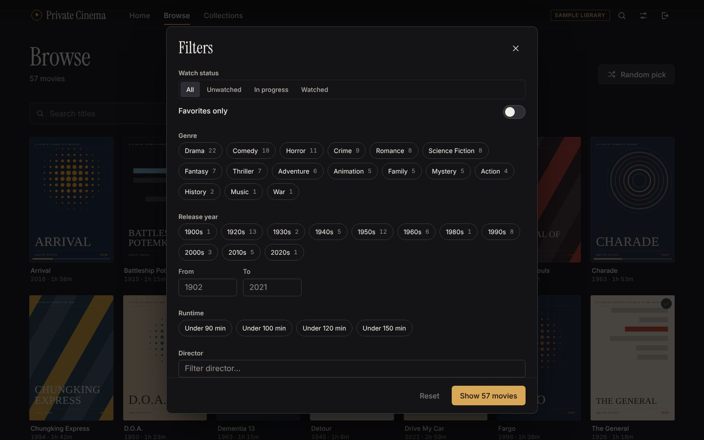
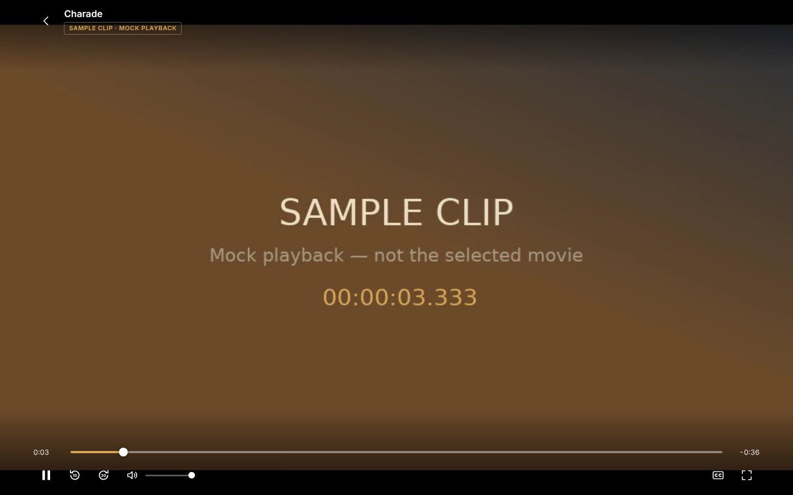
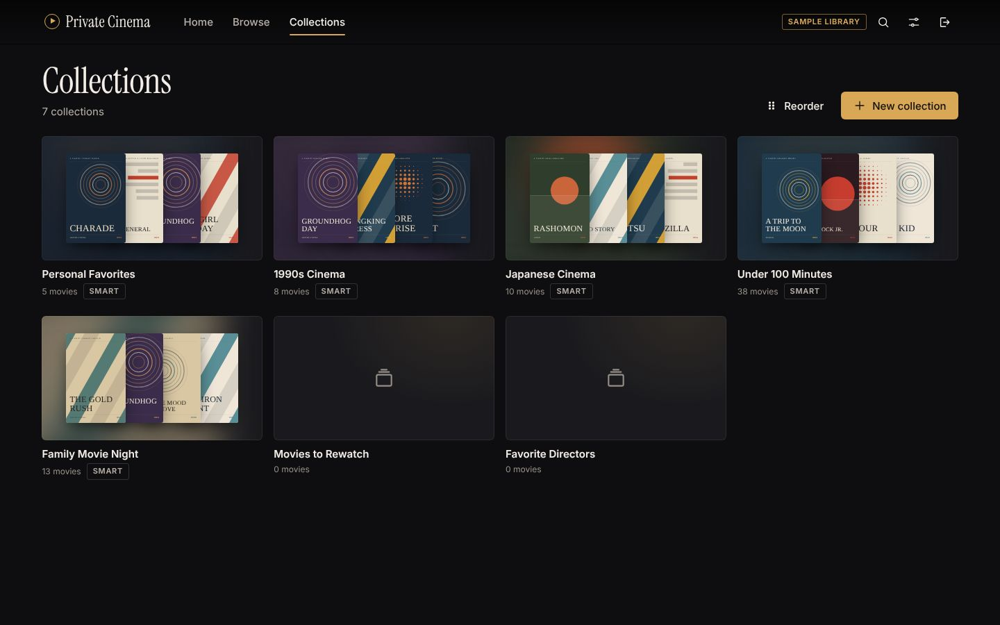

# Wheelhouse

A personal streaming interface for your own movie collection. Your films stay on your own hard drive,
[Jellyfin](https://jellyfin.org) does the media-server work (scanning, artwork, streaming, transcoding),
and Wheelhouse is the custom, cinematic front end you watch from — on your iPhone, computer, tablet
or a large screen — with your own branding, collections, notes and home layout.



| Browse                                   | Movie detail                           | Phone                                            |
| ---------------------------------------- | -------------------------------------- | ------------------------------------------------ |
|    |  |         |
|  |  |  |

> Screenshots use the built-in **sample library** (real film facts, generated artwork, and a labelled
> sample clip instead of the movie). With Jellyfin connected you see your real posters and files.

---

## Contents

1. [What it does](#what-it-does)
2. [How it fits together](#how-it-fits-together)
3. [Quick start (try it in 5 minutes)](#quick-start)
4. [Set up Jellyfin and add your movies](#set-up-jellyfin-and-add-your-movies)
5. [Connect Wheelhouse to Jellyfin](#connect-wheelhouse-to-jellyfin)
6. [Watching on your phone, TV and other devices](#watching-on-other-devices)
7. [Automatic disc ripping (insert a DVD, get a notification)](#automatic-disc-ripping)
8. [Keep it running](#keep-it-running)
9. [Backups and updates](#backups-and-updates)
10. [Remote access (outside your home)](#remote-access)
11. [Configuration reference](#configuration-reference)
12. [Troubleshooting](#troubleshooting)
13. [What has been verified, and known limitations](#verification-status-and-limitations)
14. [Development](#development)

---

## What it does

- **Home**: a featured film with backdrop (rotates; source configurable), Continue Watching, Recently Added,
  Personal Favorites, your collections, a “Spin the wheel” invitation, and genre/decade shelves. Sections can be hidden and
  reordered, and any collection can be pinned as its own row. Empty rows never appear.
- **Browse**: poster grid with search and sorting (title, year, date added, runtime, rating). One-tap
  **quick filters** for Unwatched, Genre, Runtime (under 90 min, 90 min – 2 hours, over 2 hours, epics),
  Director and Decade, plus _All filters_ for country, age rating, tag, studio, exact years and favorites.
  Loads in pages as you scroll.
- **Spin the wheel**: can’t decide? Up to 12 movies (unwatched, everything, favorites, or whatever you
  filtered in Browse) go on a prize wheel. Spin it: it ticks past each peg (with an optional click sound),
  slows down, lands on tonight’s movie and bursts into confetti, with Play, Details, Spin again and “Not
  tonight” (takes that movie off the wheel). Works with a TV remote; honours “Reduce motion”.
- **Movie detail**: backdrop, poster, synopsis, cast, director and other metadata, file format and tracks,
  Play / Resume / Start over, favorite, watched, add to collection, **your private 1–5 star rating and notes**,
  and “More like this”. Missing metadata is shown as missing — nothing is invented.
- **Collections**: hand-picked collections (add, remove, reorder, custom artwork upload or a film’s backdrop)
  and **smart collections** that fill themselves from rules. Collections can be private or shared read-only
  with the rest of the household. Starter collections are created on first sign-in (1990s Cinema, Japanese
  Cinema, Under 100 Minutes, Family Movie Night, Personal Favorites, Movies to Rewatch, Favorite Directors).
- **Who’s watching?**: the sign-in page shows each household member’s Jellyfin profile (with their Jellyfin
  avatar); tap yours and enter your password. **Switch profile** in the top bar (or the TV rail) returns to
  it. Everyone has their own Continue Watching, favorites, collections, notes and ratings.
  - A profile appears there when _“Hide this user from login screens”_ is off for that user in Jellyfin
    (_Dashboard → Users → the user → Profile_).
  - **Kids profile:** create a Jellyfin user for the kids with **no password** (one tap to sign in), and in
    _Parental control_ set a **maximum allowed rating** (e.g. PG). Jellyfin then hides everything above
    it, everywhere in Wheelhouse — rows, search, the wheel.
- **Watchlist**: bookmark movies to watch later (per person, kept in Wheelhouse); they show in a _My
  Watchlist_ row on Home, as a _Watchlist_ quick filter on Browse, and as a pool for the wheel.
- **Because you watched…**: a Home row of unwatched films like your most recent watch (same director, cast,
  genres and era first).
- **Movie night**: can’t agree? Start a vote (_/night_, or from the wheel): Wheelhouse picks a shortlist
  (unwatched, everything, favorites or watchlist) and the TV shows a 4-letter code. Everyone votes on their
  phone at `…/vote` — guests included, no account needed — and the TV updates live. Close voting to reveal
  the winner (with Play); a tie goes to the wheel.
- **Wheelhouse Wrapped** (_/wrapped_, and a Home card): your year in movies — films and hours watched,
  favourite genre and decade, month-by-month, top directors and actors, longest sit, most rewatched — for
  any year or all time. Wheelhouse keeps its own viewing history from its player; movies watched elsewhere
  count once at their last-played date.
- **Share with family**: let people outside your home watch over Tailscale (nothing on the public
  internet). _Settings → Share with family_ (administrators) walks through it and writes the invitation
  to send. Each person signs in with their own Jellyfin account.
  - **Streaming limits**: cap the quality each person gets, always or only when they're away from home,
    so remote viewers don't use up your home internet's upload.
  - **Watching now**: _Settings → Server_ shows who's playing what, where, and whether Jellyfin is
    converting it.
  - **Requests** (_/requests_, or “Ask for …” when a search finds nothing): anyone can ask for a movie.
    Your phone gets a notification (with ntfy set up), and the request is marked _Added_ by itself when
    the movie shows up in the library.
- **Film series**: Jellyfin's collections (box sets such as _Star Wars Collection_) show as a _Film
  series_ row on Home, a page per series in release order with “Up next”, and “Part of …” on each movie.
  Turn on _Dashboard → Libraries → Movies → Automatically add movies to collections_ in Jellyfin (it needs
  two films from a series before it creates the collection), then rescan.
- **People**: every director and actor name opens their page: everything of theirs in your library
  (Directed / Starring), with “Spin their movies”. Search finds people too.
- **Search**: instant search by title or director; press <kbd>/</kbd> (or <kbd>Ctrl/⌘ K</kbd>) anywhere.
- **Player**: plays the original file when the device can (direct play) and lets Jellyfin convert it when it
  can’t; resume, progress tracking, subtitles, audio-track switching, keyboard shortcuts, lock-screen controls.
- **Settings**: app name, theme (Graphite, Midnight/OLED, Sepia), accent colour, reduced motion, poster size,
  home layout, default sort, playback quality cap, resume behaviour, preferred subtitle language, direct-play
  preference, server status and diagnostics. **Everything is stored on the server, so it follows you to every
  device.**

Keyboard shortcuts in the player: <kbd>Space</kbd>/<kbd>K</kbd> play/pause · <kbd>←</kbd>/<kbd>→</kbd> ±10 s ·
<kbd>↑</kbd>/<kbd>↓</kbd> volume · <kbd>M</kbd> mute · <kbd>F</kbd> full screen · <kbd>C</kbd> cycle
subtitles · <kbd>Esc</kbd> back.

## How it fits together

```
 Phone / laptop / TV browser
          │  (one address, e.g. http://192.168.1.20:8787)
          ▼
 ┌──────────────────────────── your computer ────────────────────────────┐
 │  Wheelhouse  (Node.js, one process)                                │
 │   • serves the web app                                                 │
 │   • SQLite database: collections, notes, ratings, preferences, logins  │
 │   • signs you in *through* Jellyfin; keeps the Jellyfin token here     │
 │   • passes video/artwork through from Jellyfin (no copies, no caching  │
 │     of video, HTTP range requests so nothing downloads in full)        │
 │                 │                                                      │
 │                 ▼                                                      │
 │  Jellyfin  (media server)  ──reads──▶  2 TB drive: your movie files    │
 └────────────────────────────────────────────────────────────────────────┘
```

| Responsibility                                                 | Owned by                         |
| -------------------------------------------------------------- | -------------------------------- |
| Movie files                                                    | Your hard drive (never uploaded) |
| Library, metadata, artwork, users, watch progress, favorites   | Jellyfin                         |
| Streaming, direct play / transcoding decisions, subtitles      | Jellyfin                         |
| Collections, smart rules, notes, personal ratings, preferences | Wheelhouse (SQLite in `data/`)   |
| The interface                                                  | Wheelhouse (React)               |

**Why this design** (short version):

- **React + TypeScript + Vite** for a fast, maintainable interface; custom components and design tokens instead
  of a UI kit so it looks like _your_ product. Few runtime dependencies on the frontend (React, React Router,
  TanStack Query and hls.js — the last is only downloaded by browsers that need it — plus bundled fonts).
- **A small Node/Express backend** because collections and preferences must sync across devices (browser
  storage can’t), and because it lets the app **keep Jellyfin credentials off the client** and avoid CORS
  configuration entirely: the browser only ever talks to one address.
- **SQLite via Node’s built-in `node:sqlite`** — no database server, and nothing native to compile on Windows
  or macOS.
- **Jellyfin IDs, not titles,** are used as keys everywhere, so renaming a file or fixing a title in Jellyfin
  doesn’t break collections. If a film is removed from Jellyfin, collections show it as “no longer in your
  library” with its last known title, instead of silently dropping it.
- Sign-in uses your **Jellyfin accounts** — there is no separate user database and no public registration.

## Quick start

Requirements: **Node.js 22.13 or newer** (22 LTS recommended — download from <https://nodejs.org>) and Git.

```bash
git clone <this repository> wheelhouse
cd wheelhouse
npm install
npm run build
npm start
```

Open <http://localhost:8787>. Without Jellyfin configured, the app runs the **sample library**: sign in with
any name and the password `demo`. Everything works (collections, notes, settings, playback of a short labelled
sample clip), so you can explore before your media server is ready. A “Sample library” badge is always shown
in this mode.

## Set up Jellyfin and add your movies

1. **Install Jellyfin Server** on the same computer from the official site:
   <https://jellyfin.org/downloads/server> (Windows installer, macOS app, Linux packages, or Docker).
   Jellyfin is free and needs no cloud account.
2. Open Jellyfin at <http://localhost:8096> and complete its first-run wizard. Create an **administrator**
   account for yourself. Later, create a separate (non-administrator) account for each family member in
   _Dashboard → Users_ — those are the accounts everyone uses to sign in to Wheelhouse.
3. **Organise your movie files** on the 2 TB drive, one folder per film, named like this:

   ```
   D:\Movies\                      (or /Volumes/Media/Movies, /mnt/media/movies …)
     Arrival (2016)\Arrival (2016).mkv
     Seven Samurai (1954)\Seven Samurai (1954).mp4
     Seven Samurai (1954)\Seven Samurai (1954).en.srt     ← optional subtitles
   ```

   The year in brackets helps Jellyfin find the right metadata and artwork.

4. In Jellyfin: _Dashboard → Libraries → Add Media Library_, content type **Movies**, add the folder, keep the
   default metadata downloaders (they fetch synopses, cast and posters), save. Jellyfin scans the folder; new
   films you copy in later are picked up automatically.
5. Recommended Jellyfin settings:
   - _Dashboard → Playback → Transcoding_: enable **hardware acceleration** if your computer supports it
     (Intel Quick Sync, NVIDIA NVENC, Apple VideoToolbox). This matters for older/odd files and for phones on
     slow connections.
   - _Dashboard → Playback → Resume_: Jellyfin does not save a resume point for videos shorter than **5
     minutes** or before **5 %** of a film by default. That is normal Jellyfin behaviour.

**About your DVD reader:** Wheelhouse plays files that Jellyfin can read; it doesn’t rip discs and does not
include any copy-protection circumvention. Create digital copies of discs you own only where that is legal for
you, using software of your choice, and save them in the folder layout above. MKV or MP4 with H.264 video and
AAC audio plays directly on every device without conversion.

## Connect Wheelhouse to Jellyfin

Run the setup helper from the project folder:

```bash
npm run setup
```

It asks for the Jellyfin address (normally `http://127.0.0.1:8096` when both run on the same computer), checks
that Jellyfin answers, asks for a port and whether other devices may connect, and writes `.env`. Then:

```bash
npm start
```

Open <http://localhost:8787> and **sign in with your Jellyfin username and password**. Your real library
appears immediately; new films appear within a few minutes of Jellyfin scanning them (or press
_Settings → Server → Refresh library now_).

No passwords or API keys go into `.env`. You can check the connection at any time with
`npm run check:jellyfin`, and in the app under _Settings → Server_.

> **CORS / origins:** nothing to configure. The browser never talks to Jellyfin directly — Wheelhouse
> passes media through on the same address — so Jellyfin’s CORS settings and “known proxies” can stay at their
> defaults. If Wheelhouse runs on the same computer, Jellyfin doesn’t even need to be reachable from the
> network (though Jellyfin’s own TV apps would need that).

## Watching on other devices

When Wheelhouse starts it prints the addresses other devices can use, e.g.

```
Wheelhouse 1.0.0 listening on http://localhost:8787
  On your network: http://192.168.1.20:8787
```

- Make sure your phone/TV is on the **same Wi-Fi/network** and open that address in its browser.
- The first time, your operating system may ask whether Node.js may accept network connections — allow it on
  **private/home networks** (Windows Defender Firewall prompt, macOS “Allow incoming connections”).
- Give the host computer a **fixed address** in your router (often called “DHCP reservation”) so the address
  doesn’t change. Bookmark it.
- **iPhone/iPad:** in Safari tap _Share → Add to Home Screen_ — it then opens full-screen like an app.
- The host computer must be on (and not asleep) while you watch. Both **Jellyfin** and **Wheelhouse** must
  be running.

**Televisions:** use any reasonably modern browser on the TV or a streaming box, or a computer connected by
HDMI. Built-in smart-TV browsers vary a lot; they are _not_ guaranteed to work (see limitations). For the
living-room TV, Jellyfin’s own official apps (Android TV, Fire TV, Roku, webOS, Tizen, Apple TV via Swiftfin)
read the same Jellyfin library and watch progress — but not Wheelhouse’s collections or notes.

**TV mode.** In a smart-TV browser (LG webOS, Samsung Tizen, Fire TV, Android/Google TV), Wheelhouse
switches to a larger layout you drive with the remote:

| Remote button             | Browsing                         | Player                                                 |
| ------------------------- | -------------------------------- | ------------------------------------------------------ |
| Arrows                    | Move between posters and buttons | Left/right skip 10 s; up/down show the controls        |
| OK                        | Open / press                     | Play/pause (or press the focused control)              |
| Back                      | Close a dialog, previous page    | Close a menu → hide the controls → leave the player    |
| Play, Pause, ⏩, ⏪, Stop | —                                | Play, pause, forward 30 s, back 10 s, leave the player |

Starting a movie in TV mode goes full screen, which hides the TV browser’s toolbar. TV mode is detected
automatically; to force it on or off for one device, use **Settings → Appearance → TV mode** (it is a
per-device setting, so your phone is unaffected).

## Automatic disc ripping

With a disc drive plugged into the Wheelhouse computer, inserting a DVD is all it takes:

1. Wheelhouse notices the disc within a few seconds and reads it with **MakeMKV**.
2. It rips the main feature (the longest title) into the Rips folder, then **ejects the disc** — you can
   insert the next one while the previous movie is still being compressed.
3. It compresses the rip with **HandBrakeCLI** (preset _Fast 1080p30_, quality 20, English subtitles kept
   as tracks you can turn on) and checks the result is
   complete (same running time as the disc) before deleting the original rip.
4. It names the movie from the disc label using Jellyfin's movie lookup (`YOUNG_FRANKENSTEIN` →
   `Young Frankenstein (1974)`) and files it as `Movies/Young Frankenstein (1974) [tmdbid-3034]/Young
Frankenstein (1974).mp4`, which makes Jellyfin match the exact film.
5. It asks Jellyfin to scan, waits until the movie appears, and sends a **phone notification**: tapping it
   opens the movie in Wheelhouse.

The **Discs** page shows progress. It asks for your help instead of guessing when a disc has many
same-length titles (copy protection: pick the right one), when it looks like a TV series disc (several
episode-length titles — Wheelhouse only files movies), when the name is uncertain (several films share
a title, or the label is cryptic), or when something fails (with **Retry**). Nothing is deleted unless the
compressed movie checks out, and a finished movie in the Movies folder is never touched by **Dismiss**.

**Set up (once, about 15 minutes):**

1. Install **HandBrakeCLI** (the command-line HandBrake, a separate free download from
   <https://handbrake.fr/downloads2.php>) — `npm run setup:ripper` explains how.
2. Install the free **ntfy** app on your phone (App Store / Google Play) for notifications.
3. In Jellyfin: _Dashboard → API Keys → +_, name it "Wheelhouse".
4. Run `npm run setup:ripper` in the Wheelhouse folder and answer the questions. It checks the tools,
   creates a private random notification topic, sends a test notification and updates `.env`.
5. Restart Wheelhouse (`launchctl unload …` / `launchctl load …` if it starts automatically).

Keep the MakeMKV app closed while Wheelhouse is watching (it locks the drive). If macOS asks whether
**node** may access files on a removable volume, click **Allow**. Ripping takes about 20–30 minutes per DVD
and compression 30–60 minutes, depending on the computer. MakeMKV reads DVDs for free; Blu-ray needs a
MakeMKV key (free while MakeMKV is in beta: the current key is posted on the MakeMKV forum, enter it in
_MakeMKV → Help → Register_). Rip only discs you own.

## Keep it running

`npm start` runs until you close the window. To start Wheelhouse automatically with the computer:

- **Windows:** in an Administrator PowerShell, from the project folder:
  `powershell -ExecutionPolicy Bypass -File deploy\windows\install-startup-task.ps1`
  (log: `deploy\windows\wheelhouse.log`; remove with `Unregister-ScheduledTask -TaskName "Wheelhouse"`).
- **macOS:** edit and install `deploy/macos/com.wheelhouse.app.plist` (instructions inside the file).
- **Linux:** edit and install `deploy/linux/wheelhouse.service` (instructions inside the file).

Jellyfin’s installers already set Jellyfin up to start automatically.

Processes that must be running while anyone watches: **Jellyfin** and **Wheelhouse** (`node … dist/server/index.js`).
Also disable sleep on the host computer while it serves movies.

## Backups and updates

Wheelhouse backs up its own database (collections, notes, ratings, preferences) and uploaded artwork
**automatically once a day** into `BACKUP_DIR`, keeping the newest 14. _Settings → Server_ shows the last
backup, free space on each drive (with a warning, and a phone notification, when one is nearly full) and a
**Back up now** button. Your movies themselves are not backed up — keep the LaCie drive safe.

**What to back up:**

- Your **movie files** (the 2 TB drive) — the most valuable part; keep a second copy if you can.
- **Jellyfin’s data** (users, watch history, metadata): see Jellyfin’s backup documentation, or back up its
  data folder while Jellyfin is stopped.
- **Wheelhouse’s data** — collections, notes, ratings, preferences, uploaded artwork — all in the `data/`
  folder (or wherever `DATA_DIR` points). Create a consistent snapshot any time, even while running:

  ```bash
  npm run backup                       # → data/backups/wheelhouse-YYYY-MM-DD-HH-MM/
  npm run backup -- --out E:\Backups   # or anywhere else
  ```

  To restore: stop Wheelhouse, copy `wheelhouse.db` and `artwork/` from the backup into `data/`,
  start it again.

**Updating Wheelhouse:** if you installed it with `git clone`, open _Settings → Updates_ (administrators
only): it lists what’s new and **Update now** downloads, installs, builds and restarts Wheelhouse by itself
(when it runs as a service: launchd on a Mac, systemd on Linux; otherwise restart it yourself afterwards).
By hand, it is the same thing:

```bash
git pull
npm install
npm run build
# then restart it (or restart the service / scheduled task)
```

Installed from a downloaded zip instead? Switch to git once, keeping your settings and data:

```bash
cd ~ && git clone -b claude/peaceful-cray-8hwjin https://github.com/Evan-Wheeler3/homestream.git wheelhouse-git
cp -R wheelhouse/.env wheelhouse/data wheelhouse-git/ && mv wheelhouse wheelhouse-old && mv wheelhouse-git wheelhouse
cd wheelhouse && npm install && npm run build   # then restart the service
```

The database upgrades itself on start. Back up first, out of habit.

## Remote access

Watching away from home is a **separate, optional step** — see [docs/REMOTE_ACCESS.md](docs/REMOTE_ACCESS.md).
In short: the recommended option is **Tailscale** (a private network between your own devices; nothing exposed
to the internet), which also gives the computer a name that never changes (`http://wheelhouse:8787`),
optional HTTPS, and a way to check on or update the server from work. Avoid simply forwarding a port on your
router.

## Configuration reference

All settings live in `.env` (copy `.env.example`; `npm run setup` writes it for you). Never commit `.env`.

| Variable              | Default            | Meaning                                                                                |
| --------------------- | ------------------ | -------------------------------------------------------------------------------------- |
| `JELLYFIN_URL`        | _(empty)_          | Jellyfin address as seen from this computer. Empty = sample library.                   |
| `MEDIA_SOURCE`        | `auto`             | `auto`, `jellyfin` (fail if `JELLYFIN_URL` missing) or `mock` (always sample library). |
| `PORT`                | `8787`             | Port Wheelhouse listens on.                                                            |
| `HOST`                | `0.0.0.0`          | `0.0.0.0` = reachable on your network; `127.0.0.1` = this computer only.               |
| `DATA_DIR`            | `./data`           | Database and uploaded artwork. Back this up.                                           |
| `SESSION_DAYS`        | `30`               | Days a sign-in lasts without use.                                                      |
| `CATALOG_TTL_SECONDS` | `300`              | How often the library index is refreshed from Jellyfin.                                |
| `MOCK_PASSWORD`       | `demo`             | Password for the sample library only.                                                  |
| `COOKIE_SECURE`       | `auto`             | Secure cookies when served over HTTPS. `true` behind an HTTPS reverse proxy.           |
| `TRUST_PROXY`         | `false`            | Set `true` only behind a reverse proxy (Caddy, nginx, Tailscale Serve).                |
| `BACKUP_DIR`          | `DATA_DIR/backups` | Where the automatic daily backups go (another drive is safer).                         |
| `BACKUP_KEEP`         | `14`               | How many daily backups to keep.                                                        |
| `LOW_SPACE_GB`        | `30`               | Warn when a drive has less free space than this.                                       |

Disc ripping settings (written by `npm run setup:ripper`; see `.env.example` for all of them): `RIPPER_ENABLED`,
`MOVIES_DIR`, `RIPS_DIR`, `MAKEMKVCON`, `HANDBRAKE_CLI`, `HANDBRAKE_PRESET`, `HANDBRAKE_QUALITY`,
`HANDBRAKE_SUBTITLES` (default `eng`: English subtitle tracks are kept, off until you turn them on),
`JELLYFIN_API_KEY`, `NTFY_TOPIC`, `NTFY_SERVER` and `WHEELHOUSE_PUBLIC_URL`.

**Security model:** you sign in with Jellyfin credentials; Wheelhouse stores only a session (a random token
in an HttpOnly, SameSite cookie, hashed in the database) and keeps the Jellyfin access token on the server.
State-changing requests require a custom header (CSRF protection). Sign-in attempts are rate-limited. Only
video, subtitle and artwork paths of Jellyfin are reachable through the app — no Jellyfin admin functions, no
file-system access. Removing a device in Jellyfin (_Dashboard → Devices_) signs that browser out within a
minute. Collections are private unless you mark them shared (others can view, not edit).

## Troubleshooting

| Symptom                                                      | What to check                                                                                                                                                                                                                                      |
| ------------------------------------------------------------ | -------------------------------------------------------------------------------------------------------------------------------------------------------------------------------------------------------------------------------------------------- |
| “Cannot reach the Wheelhouse server”                         | Is the host computer on and awake, and is `npm start` / the service running? Same network? Correct address/port? Firewall prompt allowed?                                                                                                          |
| “Jellyfin is not responding” banner                          | Start Jellyfin (or wait ~30 s after a restart). The app keeps showing your cached library and recovers on its own. `npm run check:jellyfin` tests the connection.                                                                                  |
| Sign-in says “Incorrect username or password”                | Use your **Jellyfin** account. Test the same login at <http://localhost:8096>.                                                                                                                                                                     |
| “Your session expired”                                       | This browser was removed from Jellyfin’s device list (or its sign-in was revoked). Sign in again.                                                                                                                                                  |
| Library empty                                                | Check the Jellyfin library is type **Movies** and has finished scanning; then _Settings → Server → Refresh library now_. Your Jellyfin user must have access to that library (_Dashboard → Users → Access_).                                       |
| A film won’t play / “could not be decoded on this device”    | Settings → Diagnostics shows what your browser can decode and recent errors. Make sure Jellyfin transcoding works (_Dashboard → Playback_); check Jellyfin’s logs (_Dashboard → Logs_) for ffmpeg errors.                                          |
| Playback stutters                                            | Lower _Settings → Playback → Maximum streaming quality_; enable hardware acceleration in Jellyfin; prefer wired Ethernet for the host.                                                                                                             |
| Resume point not saved                                       | Jellyfin ignores very short videos and the first 5 % of a film (see Jellyfin _Dashboard → Playback → Resume_).                                                                                                                                     |
| `Port 8787 is already in use`                                | Something else uses the port (maybe a second copy). Stop it or set another `PORT` in `.env`.                                                                                                                                                       |
| `Configuration error: JELLYFIN_URL must start with http…`    | Fix the address in `.env`, e.g. `JELLYFIN_URL=http://127.0.0.1:8096`.                                                                                                                                                                              |
| Node prints `.env not found. Continuing without it.`         | Harmless: there is no `.env` yet, so defaults (sample library) are used. Run `npm run setup`.                                                                                                                                                      |
| Discs page: “MakeMKV can’t see the disc”                     | Close the MakeMKV app (it locks the drive), take the disc out and put it back in.                                                                                                                                                                  |
| Discs page: “macOS blocked access to …”                      | _System Settings → Privacy & Security → Files and Folders_ (or _Full Disk Access_): allow **node** to access removable volumes, then restart Wheelhouse.                                                                                           |
| Discs page: “opened in OS access mode … Failed to open disc” | macOS blocked the drive: _System Settings → Privacy & Security → Full Disk Access_ → turn on **node** (`open -R "$(readlink -f "$(which node)")"` shows it in Finder; drag it into the list) and **MakeMKV**; restart Wheelhouse; press **Retry**. |
| Discs page: “registration key” / “too old” / “expired”       | MakeMKV's beta key ran out (Blu-ray). Get the current key from the MakeMKV forum and enter it in _MakeMKV → Help → Register_, or update MakeMKV; press **Retry**.                                                                                  |
| Discs page: “looks like a TV series disc”                    | Wheelhouse files movies only. Rip series with the MakeMKV app; if it really is a movie, pick its title on the Discs page.                                                                                                                          |
| No phone notification                                        | Discs page → **Test notification**. The ntfy app must be subscribed to exactly the `NTFY_TOPIC` in `.env`.                                                                                                                                         |

## Verification status and limitations

Everything below was **actually run** during development; nothing is claimed from code alone.

**Verified against a real Jellyfin 12.2 server** (official Docker image, real test media with NFO metadata,
artwork, sidecar and embedded subtitles, two audio tracks, H.264/MP4, H.264/MKV, HEVC/MKV and VP9/WebM files):

- Sign-in with an administrator and a non-administrator Jellyfin account; wrong passwords rejected.
- Library listing, metadata mapping (including Jellyfin 12’s mixed camelCase/PascalCase responses), artwork
  through the authenticated proxy, items with missing metadata.
- Playback negotiation: direct play for compatible files; **remux** for H.264-in-MKV; **HEVC → H.264 HLS
  transcode** (master playlist, variant playlist and decodable `.ts` segments fetched through the proxy, with
  no access token in any playlist).
- **In a real browser:** direct play with HTTP range requests (206), WebVTT subtitles displayed, progress and
  stop reports, the resume point stored in Jellyfin, Continue Watching updated, and Resume starting at the
  saved second.
- **Audio-track switching** (the transcoded segment was measured to contain the selected track).
- Jellyfin **stopped mid-session**: cached library and detail pages stay usable, playback shows a clear message,
  and the app recovers by itself when Jellyfin returns.
- A device **revoked in Jellyfin** is signed out within a minute and can sign in again.
- Favorites toggled in Jellyfin and restored; collections referencing real Jellyfin IDs.

**Automated tests:** 126 unit/integration tests (`npm test`), 9 live Jellyfin tests (`npm run test:jellyfin`),
and 30 browser end-to-end checks (including TV-remote navigation with an LG webOS user agent) including accessibility audits with axe (`npm run test:e2e`).

**Not verified / limitations — please read:**

- **iPhone Safari and real smart TVs were not available for testing.** The iPhone path uses standard,
  well-supported mechanisms (native HLS, `playsinline`, native full screen), but it has not been tried on a
  device. Please report anything odd via _Settings → Diagnostics → Copy diagnostics_.
- The automated test browser has no H.264 decoder, so **H.264 playback inside a browser** was verified only up
  to the stream level (correct HLS segments containing H.264/AAC). Desktop Chrome, Edge, Firefox and Safari all
  decode H.264.
- **Image-based subtitles** (PGS/VobSub from Blu-ray/DVD rips) are requested as burned-in, which Jellyfin
  supports; this path was not tested with a real PGS file.
- Movies with **multiple versions** (e.g. 4K + 1080p files) play the first version Jellyfin offers.
- **Collections, notes and ratings exist only in Wheelhouse** — Jellyfin’s own apps don’t see them.
- AirPlay/Chromecast are not integrated. Safari’s native player may offer AirPlay; because streams require
  your sign-in cookie, playback on the AirPlay receiver may not work.
- Smart-collection rules support: genre, director, country, tag, studio, age rating (any/none of), release
  year, runtime, community rating, your rating (ranges), watch status, favorite, title text, and “added within
  N days”. Cast members, languages and resolution are **not** supported as rules yet.
- Requires a modern browser (2022 or newer: Safari 16.4+, Chrome/Edge 111+, Firefox 113+).
- **Disc ripping was tested with stand-ins** for MakeMKV, HandBrakeCLI, the disc drive, Jellyfin's API and
  ntfy (realistic output, including progress, copy-protection decoys, failures and restarts), but not yet
  with a real disc, MakeMKV, HandBrake or ntfy. The first real disc is the real test: watch the Discs page.

## Development

```bash
npm install
npm run dev          # API on :8787 with auto-reload + Vite on :5173 (open this one)
npm run check        # format check, lint, type-check, unit/integration tests
npm run test:e2e     # browser tests (first time: npx playwright install chromium)
JELLYFIN_TEST_URL=http://127.0.0.1:8096 JELLYFIN_TEST_USER=you JELLYFIN_TEST_PASSWORD=… npm run test:jellyfin
```

GitHub Actions (`.github/workflows/ci.yml`) runs `npm run check` and the full Playwright suite (desktop, phone
and TV) on every push and pull request, so a broken change shows up before you update the server with it.

Project layout:

```
src/client/     React app (pages/, components/, player/, lib/, styles/ — design tokens in styles/tokens.css)
src/server/     Express backend (providers/jellyfin.ts = all Jellyfin calls, proxy.ts = media pass-through,
                store.ts = database access, library.ts = home/collections logic)
src/shared/     Types and logic used by both sides (search/filter/sort, smart-collection rules, preferences)
tests/          Vitest unit + integration tests; tests/jellyfin = live tests against a real server
e2e/            Playwright end-to-end and accessibility tests (run against the sample library)
deploy/         Start-on-boot helpers for Windows, macOS and Linux
scripts/        dev runner, setup wizard, backup
assets/sample/  The labelled sample clip used by the sample library
```

Design system: colours, type scale, spacing, radii, shadows, motion and breakpoints are CSS custom properties in
`src/client/styles/tokens.css`; themes only swap colour tokens. Display type is Instrument Serif, interface
type is Inter (both bundled — no font requests to the internet).

Ideas for the next iteration: rule-based collections by cast, a “watch together” queue, per-collection
sort options for hand-picked lists via drag-and-drop, Chromecast support, and an optional Docker Compose file
that runs Jellyfin and Wheelhouse together.
